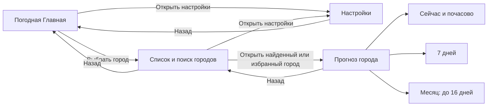
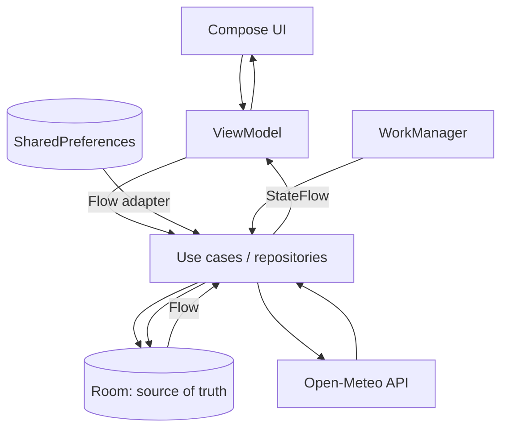

# PRD: Weather Forecast

| Параметр | Значение |
|---|---|
| Продукт | Weather Forecast |
| Платформа | Android |
| Версия документа | 1.0 |
| Дата | 31 августа 2026 |
| Статус | Готов к реализации |
| Основной источник требований | `тз123.txt` |
| Инженерные правила | [AGENTS.md](AGENTS.md) |

> **Дополнение от 20 сентября 2026 года.** Пользователь подтвердил восемь новых заданий как расширение продукта после версии 1.0. Они учтены в [RALPH_TASKS.md](RALPH_TASKS.md), WF-022–WF-029, и выполняются строго по одной задаче за итерацию. Для этих заданий подтверждение отменяет прежние ограничения об одном Gradle-модуле, стартовом экране поиска и запрете геолокации. Остальные требования версии 1.0 сохраняются, пока конкретное новое задание их не изменит. Это дополнение не означает, что новые функции уже реализованы.

## 1. Обзор продукта

Weather Forecast — Android-приложение, в котором пользователь может найти город, сразу посмотреть его прогноз без обязательного сохранения, при желании добавить город в избранное и открыть текущую, почасовую, 7-дневную и расширенную погоду на весь доступный горизонт Open-Meteo — до 16 дней.

Приложение состоит из трёх основных экранов:

1. **Главная** — погода по разрешённому приблизительному местоположению; если автоматический режим выключен, используется первый сохранённый город, а при его отсутствии предлагается выбрать город. Список избранных и поиск доступны с Главной.
2. **Прогноз** — подробные погодные данные выбранного города.
3. **Настройки** — единицы температуры, тема оформления и управление локальными данными.

Продукт не требует регистрации и хранит пользовательские данные локально на устройстве. Источник погодных данных — публичные API Open-Meteo.

## 2. Проблема и ценность

Пользователю нужен быстрый способ отслеживать погоду сразу в нескольких важных для него городах без создания аккаунта, ручного повторного поиска и сложных настроек.

Ценность продукта:

- важные города сохраняются между запусками;
- актуальная погода видна сразу на главном экране;
- детализация прогноза доступна в одном месте;
- настройки применяются мгновенно ко всему приложению;
- базовая информация остаётся доступной при временном отсутствии сети, если ранее была успешно загружена.

## 3. Цели продукта

### 3.1. Основные цели

- Дать пользователю возможность найти и добавить город в избранное не более чем за несколько действий.
- Показывать понятный прогноз для выбранного города в трёх временных представлениях.
- Сохранять избранные города и настройки после перезапуска приложения.
- Обновлять UI реактивно при изменении данных без ручной перезагрузки экрана.
- Поддерживать фоновое обновление данных избранных городов.
- Обеспечить явные и восстанавливаемые состояния загрузки, пустых данных и ошибок.

### 3.2. Учебные цели проекта

- Продемонстрировать разделение UI, доменной логики и источников данных.
- Использовать Kotlin, Jetpack Compose, Compose Navigation, Koin, Coroutines/Flow, Room, SharedPreferences, HTTP-клиент и WorkManager.
- Сделать жизненный цикл запросов и реактивных обновлений понятным и объяснимым.

### 3.3. Критерии успеха релиза

- Все обязательные пользовательские сценарии проходят без блокирующих ошибок.
- Избранные города и настройки восстанавливаются после полного перезапуска процесса приложения.
- На главном экране отображаются сохранённые погодные данные даже при временной ошибке сети.
- Для каждого сетевого состояния пользователь видит понятный результат: загрузка, данные, пустой результат или ошибка с повтором.
- Периодическая задача зарегистрирована уникально, учитывает наличие сети и обновляет кэш избранных городов.
- Основная доменная модель не зависит от Android SDK.

## 4. Целевая аудитория

### 4.1. Основной сегмент

Владельцы Android-устройств, которым важно быстро проверять погоду в нескольких городах: месте проживания, городе родственников, пункте поездки или командировки.

### 4.2. Потребности аудитории

- минимальное количество действий;
- понятные температура и погодное состояние;
- работа без аккаунта;
- сохранение выбранных городов;
- корректное отображение локального времени города;
- предсказуемое поведение при плохом интернете.

### 4.3. Продуктовые допущения

- Первая версия ориентирована на один локальный профиль на одном устройстве.
- Интерфейс первой версии — русскоязычный.
- Геолокация используется только для подтверждённого WF-026: приблизительный foreground-доступ после объяснения и действия пользователя; поиск города остаётся полноценным ручным вариантом.
- Синхронизация между устройствами не требуется.
- Монетизация и реклама не входят в текущий объём работ.

## 5. Объём релиза

### 5.1. Входит в объём

- поиск населённых пунктов через Open-Meteo Geocoding API;
- добавление найденного города в избранное без дубликатов;
- открытие прогноза найденного города без обязательного добавления в избранное;
- удаление всех избранных городов через настройки;
- список избранных с текущей температурой и погодным состоянием;
- экран прогноза с текущими/почасовыми, 7-дневными и расширенными данными;
- локальный кэш избранных городов и их последней успешно загруженной погоды;
- переключение °C/°F;
- переключение светлой/тёмной темы;
- получение погоды по приблизительному местоположению после понятного запроса разрешения;
- выключаемый автоматический режим местоположения без неявного добавления города в избранное;
- реактивное обновление интерфейса;
- обновление устаревших карточек при возврате к списку городов;
- периодическое фоновое обновление;
- анимации смены состояния, вкладок и навигационных переходов;
- состояния загрузки, пустого результата и ошибки с повтором.

### 5.2. Не входит в объём

- регистрация, вход и облачный профиль;
- фоновое отслеживание местоположения и хранение истории координат;
- push-уведомления и погодные предупреждения;
- виджеты домашнего экрана;
- карты осадков и радары;
- прогноз ровно на 30 календарных дней;
- ручная сортировка избранных городов;
- iOS, web и desktop версии;
- собственный backend;
- аналитика поведения и рекламные SDK.

## 6. Информационная архитектура и навигация



### 6.1. Правила навигации

- По подтверждённым изменениям WF-025/WF-026 стартовый экран — погодная Главная. При включённом автоматическом режиме она объясняет назначение геолокации, запрашивает только приблизительное разрешение по действию пользователя и показывает прогноз по текущим координатам. Координаты и автоматически определённое место не добавляются в избранное.
- Если автоматический режим выключен или пользователь выбирает ручной вариант, Главная показывает прогноз первого сохранённого города в стабильном порядке `addedAt, id` из Room. Если городов нет, показывается честное пустое состояние с действием «Выбрать город».
- Список избранных и поиск открываются с погодной Главной отдельным маршрутом; обычный Back из списка возвращает к погоде.
- Маршрут списка и поиска называется «Города». Над избранным он показывает отдельную карточку текущего местоположения, если автоматический режим включён. Карточка содержит определённое по координатам название населённого пункта и возвращает на существующую погодную Главную без создания её дубликата.
- Нажатие на карточку избранного города открывает его прогноз.
- У результата поиска есть отдельные действия «Открыть прогноз» и «Добавить»; открытие не изменяет список избранного.
- В маршрут сохранённого или временного прогноза передаётся только стабильный идентификатор города, а не полный объект. Временный снимок выбранного результата хранится в saveable-состоянии владельца навигации и восстанавливается вместе с back stack.
- Возврат со страницы прогноза в список городов сохраняет его состояние, включая поисковый запрос, если система не уничтожила процесс.
- Настройки доступны и с погодной Главной, и из списка городов.
- Системная кнопка «Назад» следует стандартному back stack Android.

## 7. Пользовательские сценарии

### US-01. Первый запуск

**Как пользователь**, я хочу быстро увидеть погоду рядом со мной и сохранить контроль над доступом к местоположению.

**Основной поток:**

1. Пользователь открывает приложение.
2. Видит объяснение, зачем приложению приблизительное местоположение, и действия «Разрешить местоположение»/«Выбрать город вручную».
3. После разрешения приложение один раз получает текущие координаты и показывает прогноз без добавления города в избранное.
4. При отказе или ручном выборе автоматический режим выключается, а пользователь может выбрать сохранённый город или открыть поиск.

### US-02. Поиск и добавление города

**Как пользователь**, я хочу найти город и сохранить его, чтобы не искать повторно.

**Основной поток:**

1. Пользователь вводит не менее двух символов.
2. После короткой задержки приложение выполняет поиск.
3. Пользователь видит список совпадений с названием, регионом и страной.
4. Пользователь выбирает результат.
5. Город сохраняется в избранное, результаты поиска закрываются, карточка появляется в списке городов; погодная Главная реактивно выбирает первый сохранённый город.

**Альтернативы:** нет результатов, нет сети, город уже добавлен, новый запрос заменил незавершённый старый запрос.

### US-03. Просмотр списка избранных

**Как пользователь**, я хочу видеть текущую погоду в сохранённых городах на одном экране.

### US-04. Подробный прогноз

**Как пользователь**, я хочу переключаться между краткосрочным, недельным и расширенным прогнозом выбранного города.

### US-05. Изменение единиц температуры

**Как пользователь**, я хочу выбрать °C или °F и сразу увидеть новые значения на всех экранах.

### US-06. Изменение темы

**Как пользователь**, я хочу мгновенно переключить светлую или тёмную тему.

### US-07. Очистка данных

**Как пользователь**, я хочу удалить весь список избранных городов.

### US-08. Просмотр без сохранения

**Как пользователь**, я хочу открыть прогноз найденного города, не добавляя его в избранное.

## 8. Функциональные требования

### FR-01. Список городов и поиск, доступные с погодной Главной

#### FR-01.1. Список избранных

- Экран отображает все сохранённые города.
- Карточка содержит название города, страну или регион для устранения неоднозначности, текущую температуру, единицу измерения, иконку/название погодного состояния и время последнего успешного обновления.
- Нажатие на карточку открывает экран прогноза этого города.
- Данные списка поступают реактивно из локального источника.

**Критерии приёмки:**

- Сохранённый город появляется без перезапуска экрана.
- Список восстанавливается после перезапуска приложения.
- Если обновление не удалось, последняя сохранённая погода остаётся видимой вместе с признаком устаревших данных.
- Пустой список показывает отдельное информативное состояние, а не пустой белый экран.

#### FR-01.2. Поиск города

- Поиск выполняется по строке пользователя через Geocoding API.
- Запросы из одного символа не отправляются, поскольку Open-Meteo не возвращает для них результаты.
- Рекомендуемая задержка после ввода — 300–500 мс.
- Новый текст отменяет или логически инвалидирует предыдущий запрос.
- В результате отображаются название, административный регион и страна, если поля присутствуют.
- Пустые опциональные поля API не приводят к сбою.

**Критерии приёмки:**

- Для корректного запроса отображаются релевантные результаты.
- Для пустой строки результаты скрываются.
- Для отсутствующих совпадений выводится сообщение «Ничего не найдено».
- При сетевой ошибке показываются понятное сообщение и действие «Повторить».
- Ответ на старый запрос не заменяет результаты более нового запроса.

#### FR-01.3. Добавление в избранное

- При нажатии отдельного действия «Добавить» сохраняются стабильный идентификатор Open-Meteo, название, страна/регион, широта, долгота и часовой пояс.
- Один и тот же город не может быть добавлен повторно.
- После добавления запускается получение прогноза; город может появиться сразу со статусом загрузки.

**Критерии приёмки:**

- Повторный выбор того же города не создаёт вторую запись.
- Город остаётся в списке после перезапуска.
- Ошибка получения погоды после сохранения города не удаляет город из избранного.

#### FR-01.3a. Временный просмотр найденного города

- Каждый результат поиска предоставляет отдельное действие «Открыть прогноз».
- Временный прогноз загружается по координатам выбранного результата и использует тот же экран, вкладки, единицы, погодный фон, графики и обработку ошибок, что обычный прогноз.
- Открытие прогноза не вызывает добавление города и не создаёт запись/кэш в таблицах избранного.
- Выбранный результат сохраняется на уровне навигации через saveable-примитивы; маршрут содержит только стабильный ID. Back возвращает к сохранённому состоянию поиска.

**Критерии приёмки:**

- Нажатие «Открыть прогноз» показывает выбранный город и его фактический прогноз.
- Список избранного остаётся неизменным до отдельного нажатия «Добавить».
- Ошибка сети показывает безопасное сообщение и «Повторить»; успешный уже показанный временный прогноз не исчезает при ошибке повторного запроса.
- Поворот/recreation UI не теряет выбранный город; после полного выхода из временного прогноза он не становится постоянным локальным избранным.

#### FR-01.4. Обновление при возврате к списку городов

- При повторном появлении списка городов приложение проверяет актуальность данных и обновляет устаревшие записи.
- Одновременные обновления одного города не должны дублироваться.

**Критерии приёмки:**

- Возврат к списку городов инициирует обновление устаревших данных без отдельной кнопки.
- Во время обновления существующий кэш не исчезает.
- Новые данные автоматически отражаются в карточках.

### FR-02. Экран прогноза

#### FR-02.1. Общие требования

- Погодная Главная использует этот же экран прогноза для первого сохранённого города. При первом запуске без городов она показывает отдельное пустое состояние с переходом к поиску; при загрузке списка — индикатор без фиктивных значений.
- На погодной Главной доступны действия выбора города и открытия настроек; при открытии прогноза из списка остаётся обычная кнопка «Назад».
- Заголовок содержит название города и работает как кнопка перехода к экрану «Города». Кнопка Back на экране городов возвращает тот же экземпляр прогноза с ранее выбранной вкладкой.
- Экран поддерживает состояния: начальная загрузка, данные, обновление поверх данных, ошибка без данных, ошибка при наличии кэша.
- При ошибке без данных доступно действие «Повторить».
- При смене единиц температуры экран обновляется без повторного открытия.

#### FR-02.2. Вкладка «Сейчас»

- Показывает текущую температуру и погодное состояние.
- Показывает почасовые значения ближайших часов в локальном времени выбранного города.
- Прошедшие часы текущего дня не должны доминировать в списке; начальная позиция — ближайший доступный час.
- Под почасовым списком показывает два компактных графика для ближайших шести фактически доступных часов: температуру и вероятность осадков.
- Графики используют только точки ответа API, не интерполируют пропуски и показывают время города. Температура немедленно следует выбранной единице.

**Критерии приёмки:**

- Текущая температура и состояние присутствуют при полном ответе API.
- Почасовые времена и температуры сопоставляются по одинаковым индексам.
- Подписи графиков численно дублируют значения, поэтому высота/цвет столбца не являются единственным носителем смысла; screen reader получает текстовое описание каждой точки.
- Если API вернул меньше шести будущих часов, показывается только фактически доступное количество; без почасовых данных графики не рисуются.
- Отсутствующее погодное поле отображается нейтральным значением, не вызывает сбой.

#### FR-02.3. Вкладка «7 дней»

- Показывает семь календарных дней, начиная с текущего дня.
- Для каждого дня отображаются дата/день недели, минимальная и максимальная температура, погодное состояние.
- Первый день, совпадающий с текущей датой в часовом поясе города, подписывается «Сегодня» вместо названия дня недели.
- Дневные карточки расположены компактным центрированным списком: на телефоне они визуально уже рабочей области, а на широком экране имеют ограничение максимальной ширины.

**Критерии приёмки:**

- При наличии данных API отображаются ровно первые 7 дней.
- Минимум и максимум визуально различимы и используют выбранную единицу.
- Даты интерпретируются в часовом поясе города.
- Подпись «Сегодня» определяется по часовому поясу выбранного города, а не устройства.
- Более узкая карточка сохраняет дату, погодное состояние, минимум, максимум и вероятность осадков; её минимальная высота остаётся не меньше 48 dp.
- Нажатие реального дня открывает отдельное подробное представление с фоном его погодного состояния, датой, минимумом, максимумом, осадками, восходом и закатом, если эти поля доступны. Back возвращает к списку «7 дней».
- Подробное представление не подставляет текущие влажность, давление или ветер в будущий день и прямо сообщает, что показывает только доступные дневные данные.

#### FR-02.4. Вкладка «Месяц»

- Название вкладки сохраняется согласно ТЗ.
- Вкладка показывает весь доступный прогноз API: максимум 16 дней, а не искусственно рассчитанные 30 дней.
- Рядом с заголовком или над списком видна постоянная подпись «Доступно до 16 дней».
- Показывается предупреждение, что точность дальнего прогноза снижается.
- Даты текущего месяца расположены календарной сеткой с семью колонками и русскими подписями дней недели.
- Все 28–31 календарные даты видны, но погодными и интерактивными являются только даты, присутствующие в реальном ответе API (максимум 16 дней); остальные явно помечены как недоступные.

**Критерии приёмки:**

- Приложение не генерирует данные за пределами ответа API.
- Пользователь до просмотра списка понимает, почему показано меньше месяца.
- Если API вернул меньше 16 дней, экран корректно показывает доступное количество.
- Нажатие доступной даты открывает подробный экран этого дня, Back возвращает к календарю; недоступная дата не создаёт прогноз и не реагирует на нажатие.

#### FR-02.5. Анимации

- Переключение вкладок сопровождается короткой ненавязчивой анимацией.
- Смена погодной иконки может быть анимирована.
- Переход между главным экраном и прогнозом визуально непрерывен.
- Анимации не блокируют ввод и учитывают системную настройку уменьшения анимации, где применимо.

### FR-03. Настройки

#### FR-03.1. Единицы температуры

- Доступны значения «Цельсий (°C)» и «Фаренгейт (°F)».
- Значение по умолчанию — °C.
- Изменение сохраняется локально и публикуется как реактивное состояние.
- Для мгновенного и офлайн-переключения кэш рекомендуется хранить в °C, а преобразование выполнять на границе представления.

**Критерии приёмки:**

- Все видимые температуры меняются сразу после выбора единицы.
- Настройка сохраняется после перезапуска.
- Преобразование использует единое правило округления во всём приложении.

#### FR-03.2. Тема оформления

- Доступны светлая и тёмная темы.
- Первая версия не обязана иметь вариант «Как в системе».
- Тема применяется ко всему дереву Compose без пересоздания пользовательского маршрута.

**Критерии приёмки:**

- Все три экрана меняют тему сразу.
- Контраст текста, фона и интерактивных элементов остаётся достаточным.
- Выбранная тема сохраняется после перезапуска.

#### FR-03.3. Автоматическая погода по местоположению

- Настройка «Автоматическое получение погоды из локации» по умолчанию включена.
- Системное разрешение запрашивается только после объяснения и явного действия пользователя; достаточно приблизительного foreground-доступа.
- При включённой настройке погодная Главная получает одну актуальную позицию и запрашивает прогноз по координатам.
- Полученные координаты по возможности преобразуются системным геокодером Android в название ближайшего города. Это название показывается в заголовке погодной Главной и в карточке текущего местоположения над избранным; ошибка геокодирования не блокирует прогноз по координатам.
- Автоматически определённое место не добавляется в избранное, координаты не сохраняются в Room/SharedPreferences и не выводятся в логи.
- При выключении настройки Главная возвращается к первому сохранённому городу либо честному пустому состоянию.

**Критерии приёмки:**

- Без разрешения экран не читает местоположение и предлагает ручной выбор города.
- Отказ в разрешении не вызывает crash и выключает автоматический режим.
- Ошибка или выключенная геолокация показывает восстанавливаемую ошибку с повтором.
- После успешного определения города экран «Города» показывает его над избранным, а нажатие возвращает к прогнозу текущего местоположения.
- Настройка сохраняется после перезапуска и может быть снова включена через системный запрос разрешения.

#### FR-03.4. Очистка избранного

- Действие удаляет города и связанный погодный кэш.
- Перед необратимым действием показывается подтверждение.
- При пустом списке действие недоступно или явно сообщает, что удалять нечего.

**Критерии приёмки:**

- Отмена диалога не изменяет данные.
- Подтверждение очищает список и возвращает главный экран в пустое состояние.
- После перезапуска удалённые записи не восстанавливаются.

### FR-04. Фоновое обновление

- WorkManager регистрирует одну уникальную периодическую задачу.
- Рекомендуемый период первой версии — 3 часа.
- Условие запуска — доступное сетевое соединение.
- Задача загружает данные только для текущих избранных городов и сохраняет успешные ответы в Room.
- Частичный сбой одного города не должен откатывать успешные обновления остальных.
- Временные сетевые ошибки допускают повтор с backoff.
- Расписание WorkManager является приблизительным: Doze и оптимизация батареи могут отложить запуск.

**Критерии приёмки:**

- Повторная инициализация приложения не создаёт несколько одинаковых периодических задач.
- После успешного фонового запуска время обновления и данные меняются в локальном кэше.
- При отсутствии сети задача не стирает существующие данные.
- Ошибка одного города не завершает обработку остальных без попытки.

### FR-05. Состояния и обработка ошибок

Для каждого сетевого экрана должны быть предусмотрены:

| Состояние | Поведение UI |
|---|---|
| Начальная загрузка | Индикатор или skeleton, без ложных нулевых значений |
| Данные | Полный контент |
| Обновление | Старые данные остаются видимыми, отображается компактный прогресс |
| Пустой результат | Объяснение и следующее доступное действие |
| Ошибка без кэша | Сообщение и кнопка «Повторить» |
| Ошибка с кэшем | Кэш остаётся видимым, показывается ненавязчивое предупреждение |

Технические сообщения, HTTP-коды и stack trace пользователю не показываются.

## 9. Интеграция с Open-Meteo

### 9.1. Геокодинг

**Endpoint:** `GET https://geocoding-api.open-meteo.com/v1/search`

Рекомендуемые параметры:

| Параметр | Значение/источник | Назначение |
|---|---|---|
| `name` | поисковая строка | Обязательный запрос |
| `count` | 10 | Ограничение списка |
| `language` | `ru` | Локализованные названия, если доступны |
| `format` | `json` | Формат ответа |

Используемые поля результата: `id`, `name`, `latitude`, `longitude`, `country`, `country_code`, `admin1`, `timezone`.

### 9.2. Прогноз

**Endpoint:** `GET https://api.open-meteo.com/v1/forecast`

Обязательные категории параметров:

- координаты: `latitude`, `longitude`;
- текущие данные: температура, код погоды, признак дня/ночи;
- почасовые данные: температура и код погоды;
- дневные данные: минимальная/максимальная температура и код погоды;
- `forecast_days=16`;
- `timezone=auto`.

Примечание: ТЗ приводит совместимый запрос с `current_weather=true`. Для новой интеграции следует ориентироваться на актуально документированный параметр `current` и явно запрашивать нужные поля. Конкретные DTO должны соответствовать фактическому контракту выбранного варианта API.

### 9.3. Правила интеграции

- API-DTO не передаются напрямую в UI.
- Сетевые данные преобразуются в доменные модели.
- Массивы времени и значений валидируются перед объединением по индексу.
- Необязательные поля обрабатываются как nullable.
- Неизвестный WMO weather code отображается нейтральной иконкой и текстом «Неизвестно».
- Тайм-ауты, отсутствие сети, HTTP-ошибки и ошибки разбора различаются внутри приложения, но получают простые пользовательские формулировки.
- Приложение не содержит API-ключ: бесплатный публичный доступ Open-Meteo не требует его для заявленного сценария. Перед коммерческим выпуском нужно повторно проверить условия использования и атрибуцию.

## 10. Концептуальная модель данных

### 10.1. Доменная модель `City`

| Поле | Тип | Обязательность | Назначение |
|---|---|---|---|
| `id` | Long/String | Да | Стабильный идентификатор локации |
| `name` | String | Да | Название города |
| `country` | String? | Нет | Страна |
| `countryCode` | String? | Нет | ISO-код страны |
| `admin1` | String? | Нет | Регион первого уровня |
| `latitude` | Double | Да | Широта WGS84 |
| `longitude` | Double | Да | Долгота WGS84 |
| `timezone` | String? | Нет | Часовой пояс локации |

### 10.2. Доменная модель `CurrentWeather`

| Поле | Тип | Обязательность | Назначение |
|---|---|---|---|
| `cityId` | Long/String | Да | Связь с городом |
| `temperatureCelsius` | Double | Да | Каноническое значение для хранения |
| `weatherCode` | Int? | Нет | WMO-код состояния |
| `isDay` | Boolean? | Нет | Выбор дневной/ночной иконки |
| `observedAt` | DateTime? | Нет | Время измерения API |
| `updatedAt` | Instant | Да | Время успешного сохранения |

### 10.3. Доменная модель `HourlyForecastPoint`

| Поле | Тип | Назначение |
|---|---|---|
| `cityId` | Long/String | Связь с городом |
| `time` | LocalDateTime | Локальные дата и час |
| `temperatureCelsius` | Double | Температура |
| `weatherCode` | Int? | Состояние погоды |

### 10.4. Доменная модель `DailyForecastPoint`

| Поле | Тип | Назначение |
|---|---|---|
| `cityId` | Long/String | Связь с городом |
| `date` | LocalDate | Локальная дата |
| `minTemperatureCelsius` | Double | Минимум |
| `maxTemperatureCelsius` | Double | Максимум |
| `weatherCode` | Int? | Сводное состояние |

### 10.5. Настройки

| Ключ | Тип | Значение по умолчанию |
|---|---|---|
| `temperature_unit` | Enum/String: `CELSIUS`, `FAHRENHEIT` | `CELSIUS` |
| `theme_mode` | Enum/String: `LIGHT`, `DARK` | `LIGHT` |

### 10.6. Связи и хранение

- `City` имеет ноль или одну запись текущей погоды и набор почасовых/дневных точек.
- Удаление города должно каскадно удалять связанный кэш.
- Room является источником истины для избранного и сохранённой погоды.
- SharedPreferences используется только для небольших пользовательских настроек, как явно задано в ТЗ.
- Данные поисковой выдачи не обязаны сохраняться после завершения поиска.

## 11. Архитектурные рекомендации

### 11.0. Управление техническими решениями

[AGENTS.md](AGENTS.md) является обязательным инженерным источником для реализации этого PRD. Он определяет архитектурные границы, направление зависимостей, правила состояния UI, offline-first поведение, тестирование, безопасность изменений и рабочий процесс агента.

Правила разрешения решений:

- PRD определяет **что** должно быть реализовано: продуктовый scope, сценарии и критерии приёмки.
- [AGENTS.md](AGENTS.md) определяет **как** это реализуется технически и как проверяется результат.
- Явная текущая просьба пользователя имеет приоритет над обоими документами.
- Если предлагаемое техническое решение противоречит `AGENTS.md`, исполнитель должен остановиться, описать противоречие и получить решение пользователя, а не обходить правило молча.
- Если задача допускает несколько технических вариантов, сначала применяется вариант, согласованный с `AGENTS.md`, текущим стеком и минимальным безопасным diff.

### 11.1. Модули

Целевая структура:

```text
app                 — Application, Activity, навигация, корневой DI-граф
core:common         — Result/error abstractions, Kotlin-утилиты
core:model          — чистые доменные модели
core:network        — Open-Meteo API, DTO, сетевые mapper'ы
core:database       — Room entities, DAO, database mapper'ы
core:ui             — тема, компоненты, погодные иконки
feature:home        — data/domain/presentation главного экрана
feature:forecast    — data/domain/presentation прогноза
feature:settings    — data/domain/presentation настроек
```

Физическое разделение на Gradle-модули допускается выполнять поэтапно. Границы зависимостей должны соблюдаться с первого этапа даже при временном размещении кода в одном Android-модуле.

### 11.2. Поток данных



Основные правила:

- UI отправляет события и отображает immutable UI state.
- ViewModel не хранит Android View и не выполняет сетевые вызовы напрямую.
- Repository координирует сеть и локальное хранилище.
- После успешного ответа сеть обновляет Room; UI получает изменения через Flow.
- Операции привязаны к lifecycle ViewModel; уход с экрана отменяет ненужную UI-работу, но Room сохраняет уже успешно завершённые записи.
- Koin создаёт API, базу, DAO, repositories, worker dependencies и ViewModel; ручное создание зависимостей внутри экранов запрещено.

### 11.3. Технологический стек

| Область | Решение | Обоснование |
|---|---|---|
| Язык | Kotlin | Требование ТЗ, coroutines и null safety |
| UI | Jetpack Compose + Material 3 | Декларативный реактивный интерфейс |
| Навигация | Navigation Compose | Единый Compose back stack |
| DI | Koin | Явная сборка зависимостей и удобная интеграция с ViewModel |
| Асинхронность | Coroutines + Flow/StateFlow | Отмена, реактивные данные и lifecycle-aware сбор |
| База | Room | Структурированные избранные и погодный кэш |
| Настройки | SharedPreferences | Прямое требование ТЗ |
| HTTP | Retrofit **или** Ktor Client | Выбрать один клиент на весь проект; для учебного Android-only проекта рекомендуется Retrofit |
| Фон | WorkManager | Надёжная отложенная работа с учётом ограничений Android |

Хотя Android рекомендует DataStore для новых key-value настроек, в этой версии сохраняется SharedPreferences для соответствия ТЗ. Миграция на DataStore указана как возможное улучшение.

## 12. Принципы UI и UX

- **Понятность:** погода считывается за несколько секунд; температура — главный визуальный акцент.
- **Согласованность:** одинаковые погодные коды всегда имеют одинаковые название, цвет и иконку.
- **Погодный фон:** экран заполненного прогноза выбирает градиент по текущему WMO-состоянию. Ясная погода передаётся ярким жёлто-золотым цветом, облачная — ненасыщенным серым, туман — дымчатым, морось/дождь — холодными синими разной глубины, снег — ледяным голубым, гроза — тёмным фиолетовым. Loading/empty/error без данных используют нейтральный фон. Для светлой и тёмной темы используются отдельные контрастные палитры; на светлых погодных фонах UI автоматически переходит на тёмный текст и затемнённые glass-поверхности.
- **Не только цвет:** название и иконка состояния остаются видимыми, поэтому смена фона служит атмосферой и быстрым дополнительным сигналом, а не единственным объяснением погоды.
- **Состояния вместо пустоты:** пользователь всегда понимает, что происходит и что можно сделать дальше.
- **Кэш без обмана:** устаревшие данные маркируются временем последнего обновления.
- **Доступность:** интерактивная зона не менее 48 dp, текстовые подписи для иконок, поддержка увеличенного системного шрифта, отсутствие передачи смысла только цветом.
- **Адаптивность:** основные экраны остаются пригодными для компактных Android-устройств и горизонтальной ориентации; списки прокручиваются.
- **Предсказуемость:** очистка данных требует подтверждения; повтор сетевого запроса всегда доступен при блокирующей ошибке.

## 13. Нефункциональные требования

### NFR-01. Производительность

- Ввод в поиске и прокрутка списков не блокируются дисковыми или сетевыми операциями.
- Запись Room и SharedPreferences не выполняется синхронно на главном потоке.
- UI не выполняет тяжёлые преобразования при каждой recomposition.

### NFR-02. Надёжность

- Приложение не падает из-за отсутствующих опциональных полей API.
- Последний успешный кэш не удаляется при сетевой ошибке.
- Конкурирующие ответы не могут перезаписать более актуальный результат поиска.
- Миграции схемы Room добавляются при каждом изменении схемы; destructive migration не используется в релизной сборке без осознанного решения.

### NFR-03. Совместимость

- Минимальная и целевая версии Android определяются конфигурацией проекта и фиксируются перед релизом.
- Поведение проверяется минимум на одной минимально поддерживаемой и одной актуальной версии Android.

### NFR-04. Офлайн-поведение

- Поиск новых городов без сети недоступен и объясняет причину.
- Ранее сохранённые города и погодный кэш доступны без сети.
- Смена темы и единиц работает офлайн.

### NFR-05. Наблюдаемость

- Технические ошибки логируются без персональных данных и без показа пользователю внутренних деталей.
- Фоновые обновления имеют диагностируемый результат для тестирования.

## 14. Безопасность и приватность

- Аутентификация не требуется, поскольку нет серверного пользовательского профиля.
- Для WF-026 приложение объявляет только `ACCESS_COARSE_LOCATION`: приблизительное местоположение запрашивается в контексте функции и только после объяснения. Точный и фоновый доступ не объявляются.
- Координаты существуют только на время запроса прогноза по HTTPS к Open-Meteo, не записываются в Room/SharedPreferences и не попадают в release-логи. Автоматически найденное место не меняет избранное.
- Контакты, фото и другие пользовательские разрешения не запрашиваются.
- Сетевое взаимодействие выполняется только по HTTPS.
- В логах не должны сохраняться полные ответы API или иные лишние пользовательские данные в release-сборке.
- Room и SharedPreferences размещаются во внутреннем хранилище приложения.
- Настройки резервного копирования Android должны быть осознанно проверены: избранные города не являются секретом, но пользователь должен иметь возможность полностью очистить их.
- Внешние URL и строки ошибок не исполняются и не интерпретируются как команды.
- Перед публичным распространением проверяются актуальные условия Open-Meteo, лицензирование и требования атрибуции.

## 15. Этапы разработки

Все этапы выполняются по рабочему процессу из [AGENTS.md](AGENTS.md): аудит текущего состояния, небольшой вертикальный срез, реализация вместе с тестами, узкие проверки, затем проверки пропорционально риску. Подробная последовательность задач для автономного цикла находится в [RALPH_TASKS.md](RALPH_TASKS.md).

### Milestone 1. Базовая рабочая версия

**Результат:** связанный каркас из трёх экранов с рабочим поиском и локальным избранным.

- Создать навигацию и DI-граф.
- Описать чистые доменные модели.
- Подключить геокодинг и базовый прогноз.
- Реализовать Room для городов.
- Реализовать главный экран, экран прогноза «Сейчас» и настройки с очисткой.
- Добавить состояния загрузки, пустого результата и ошибки для поиска.

**Definition of Done:**

- три экрана доступны через навигацию;
- поиск и добавление города работают;
- город сохраняется в Room;
- текущая и почасовая погода отображаются;
- очистка избранного работает после подтверждения;
- доменные модели не зависят от Android;
- зависимости создаются через Koin;
- ключевая логика поиска и хранения покрыта unit-тестами.

### Milestone 2. Полный пользовательский сценарий

**Результат:** постоянные данные, карточки погоды, недельный прогноз и настройки отображения.

- Добавить текущую погоду в карточки избранного.
- Сохранять погодный кэш.
- Добавить вкладку «7 дней».
- Реализовать °C/°F и светлую/тёмную тему.
- Сделать настройки реактивными.

**Definition of Done:**

- данные переживают перезапуск;
- недельный прогноз показывает 7 дней;
- смена единиц и темы мгновенно отражается на всех экранах;
- сценарии кэша и ошибок проверены тестами.

### Milestone 3. Фоновое обновление и полировка

**Результат:** финальная функциональность из ТЗ.

- Добавить обновление при возврате на главный экран.
- Добавить уникальную периодическую задачу WorkManager.
- Добавить вкладку «Месяц» с горизонтом до 16 дней и предупреждением.
- Завершить модель состояний всех экранов.
- Добавить анимации и accessibility-проверки.
- Проверить отмену запросов и конкурентные обновления.

**Definition of Done:**

- UI обновляется реактивно;
- все три вкладки прогноза работают;
- фоновые обновления доказуемо обновляют Room;
- повтор после ошибки работает;
- анимации не нарушают доступность и взаимодействие;
- все обязательные критерии приёмки PRD выполнены.

## 16. Стратегия тестирования

### 16.1. Unit-тесты

- преобразование °C ↔ °F и округление;
- маппинг WMO weather code в доменное состояние;
- DTO → domain и entity → domain;
- объединение массивов времени и значений;
- защита от массивов разной длины;
- отмена/инвалидация устаревшего поискового запроса;
- логика определения устаревшего кэша;
- ViewModel state transitions;
- поведение repository при успехе сети, ошибке с кэшем и ошибке без кэша.

### 16.2. Интеграционные тесты

- Room DAO и каскадное удаление;
- сохранение/чтение настроек;
- API parsing на сохранённых примерах ответов;
- Worker с тестовым WorkManager и подменённым repository.

### 16.3. UI-тесты

- пустая погодная Главная → список и поиск → добавление → открытие прогноза;
- переключение вкладок;
- повтор после ошибки;
- смена темы и единиц;
- подтверждение и отмена очистки;
- восстановление навигации и состояния после пересоздания Activity.

### 16.4. Ручная проверка

- отсутствие сети на каждом экране;
- медленная сеть;
- одинаковые названия городов в разных странах;
- системный крупный шрифт;
- светлая/тёмная тема;
- перезапуск приложения и процесса;
- отложенный запуск WorkManager из-за системных ограничений.

## 17. Риски и способы снижения

| Риск | Влияние | Мера |
|---|---|---|
| Вкладка «Месяц» воспринимается как 30 дней | Потеря доверия | Постоянно показывать «до 16 дней» и предупреждение о точности |
| Неоднозначные названия городов | Выбран неверный город | Показывать регион и страну |
| API возвращает неполные массивы | Сбой или неверное сопоставление | Валидация длины и безопасное объединение |
| Фоновая работа запускается позже ожидаемого | Несвежие карточки | Показывать время обновления и обновлять при возврате в приложение |
| Частые запросы при вводе | Лишняя нагрузка и скачущий UI | Debounce, отмена/инвалидация предыдущих запросов |
| Смена единиц требует сети | Плохой UX офлайн | Хранить канонические значения в °C и преобразовывать локально |
| SharedPreferences блокирует поток | Подвисания UI | Инкапсулировать доступ, не выполнять синхронные записи в UI; позже мигрировать на DataStore |
| Разрастание модульности на раннем этапе | Замедление учебной разработки | Сначала соблюдать логические границы, затем выделять Gradle-модули |

## 18. Будущие расширения

- системная тема;
- индивидуальное удаление и ручная сортировка городов;
- осадки, ветер, влажность и ощущаемая температура;
- уведомления об опасной погоде;
- виджет Android;
- синхронизация избранного между устройствами;
- миграция SharedPreferences на Preferences DataStore;
- локализация интерфейса;
- планшетный двухпанельный layout;
- экспорт/импорт избранных городов.

## 19. Открытые продуктовые решения

Эти пункты не блокируют начало разработки; ниже указаны значения по умолчанию для первой версии.

| Вопрос | Значение по умолчанию |
|---|---|
| Разрешено ли удалять один город отдельно? | Нет, только полная очистка по исходному ТЗ |
| Какой порядок избранного? | Порядок добавления, новые города внизу |
| Сколько результатов поиска показывать? | До 10 |
| Какой debounce поиска? | 400 мс |
| Как часто обновлять в фоне? | Примерно раз в 3 часа |
| Когда кэш считать устаревшим? | Через 60 минут для обновления при возврате |
| Какая тема по умолчанию? | Светлая |
| Какие единицы по умолчанию? | Цельсий |
| Нужен ли режим «Как в системе»? | Не в первой версии |
| Как назвать третью вкладку? | «Месяц», с постоянной подписью «до 16 дней» |

## 20. Матрица итоговой приёмки

- [ ] Приложение имеет ровно три основные пользовательские зоны: Главная, Прогноз, Настройки.
- [ ] Поиск различает одноимённые города по региону/стране.
- [ ] Город добавляется без дубликатов и переживает перезапуск.
- [ ] Найденный город открывается без добавления в избранное, а Back возвращает к поиску.
- [ ] Карточки показывают текущую погоду и время обновления.
- [ ] Экран прогноза содержит «Сейчас», «7 дней» и «Месяц».
- [ ] «Месяц» не показывает выдуманный 30-дневный прогноз и объясняет лимит 16 дней.
- [ ] Все сетевые экраны имеют загрузку, данные, пустое состояние и восстанавливаемую ошибку.
- [ ] При сетевой ошибке сохранённый кэш не исчезает.
- [ ] °C/°F и тема применяются мгновенно и сохраняются.
- [ ] После согласия приблизительное местоположение показывает прогноз на Главной; отказ сохраняет ручной fallback, а координаты не добавляются в избранное.
- [ ] Очистка требует подтверждения и удаляет связанный кэш.
- [ ] Возврат к списку городов обновляет устаревшие карточки.
- [ ] Зарегистрирована одна уникальная периодическая задача WorkManager.
- [ ] Worker не запускается без сети и не стирает данные при ошибке.
- [ ] UI получает данные через Flow/StateFlow и не блокирует главный поток.
- [ ] Доменный слой не зависит от Android SDK.
- [ ] Все обязательные зависимости собираются через Koin.
- [ ] Критические сценарии покрыты unit-, integration- и UI-тестами.

## 21. Справочные материалы

- [AGENTS.md — технические решения и workflow](AGENTS.md)
- [RALPH_TASKS.md — исполняемый backlog Ralph-цикла](RALPH_TASKS.md)
- [Open-Meteo Weather Forecast API](https://open-meteo.com/en/docs)
- [Open-Meteo Geocoding API](https://open-meteo.com/en/docs/geocoding-api)
- [Android WorkManager: PeriodicWorkRequest](https://developer.android.com/reference/androidx/work/PeriodicWorkRequest)
- [Android: асинхронные запросы Room](https://developer.android.com/training/data-storage/room/async-queries)
- [Android: Navigation Compose testing and separation](https://developer.android.com/guide/navigation/testing/compose)
- [Android: SharedPreferences](https://developer.android.com/training/data-storage/shared-preferences)
- [Koin for Compose](https://insert-koin.io/docs/reference/koin-compose/compose/)

## 22. История изменений

| Версия | Дата | Изменения |
|---|---|---|
| 1.0 | 31.08.2026 | Первичная версия PRD на основе ТЗ |
